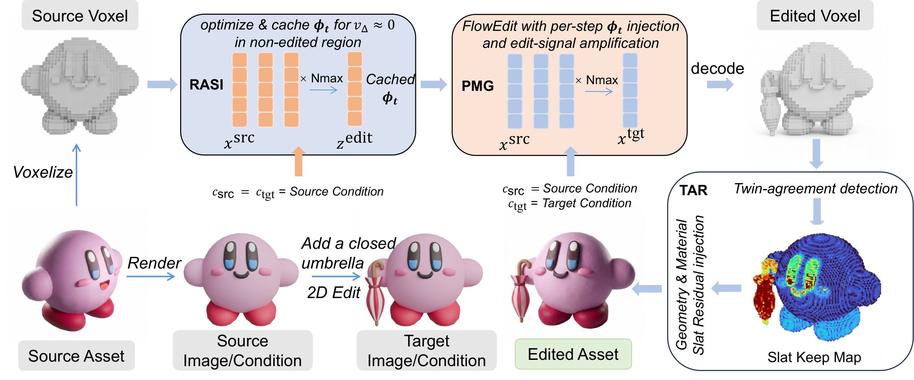
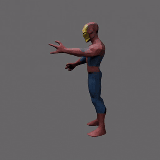
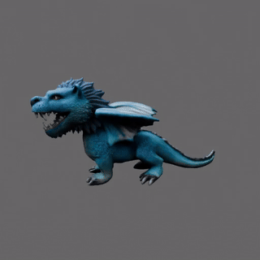
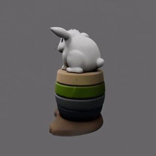

<div align="center">

<h1>VS3D</h1>
<h3>Velocity-Space 3D Asset Editing</h3>

<p><strong>NeurIPS 2026</strong></p>

<a href="https://arxiv.org/abs/2605.07385"></a>

<p>Inversion-free · Training-free · Mask-free</p>

<p>
<a href="#method">Method</a> &nbsp;·&nbsp;
<a href="#results">Results</a> &nbsp;·&nbsp;
<a href="#installation">Installation</a> &nbsp;·&nbsp;
<a href="#weights-and-configuration">Weights</a> &nbsp;·&nbsp;
<a href="#usage">Usage</a>
</p>

</div>

VS3D is an inversion-free, training-free, and mask-free framework for
local 3D asset editing. Given a source 3D asset and a pair of images showing its
current and desired appearance, VS3D applies the requested edit while preserving
non-edited geometry and materials.

Official implementation of [Velocity-Space 3D Asset Editing](https://arxiv.org/abs/2605.07385).

## Method

<a href="assets/paper/pipeline.png"></a>

<p align="center"><sub>VS3D pipeline overview from the paper. Click the figure for full resolution.</sub></p>

Built on the frozen TRELLIS.2 generator, VS3D addresses identity drift and weak
edit signals through interventions inside the sampling process, rather than
manual 3D edit masks, post-hoc voxel merging, or multi-view reconstruction:

- **Reconstruction-Anchored Source Injection (RASI)** calibrates a per-step,
  asset-specific unconditional embedding through source reconstruction to
  suppress identity leakage in the sparse-structure editing stage.
- **Partial-Mean Guidance (PMG)** contrasts full- and partial-sample estimates
  of the source–target velocity difference to strengthen the consistent edit
  signal while preserving regions with little or no edit signal.
- **Twin-Agreement Residual Injection (TAR)** compares source- and
  target-conditioned samples on the same sparse scaffold and noise, then
  injects source-encoded residuals into agreeing tokens to preserve geometry
  and materials outside the edit.

## Results

<table>
<tr>
<td align="center" width="33%">
<a href="assets/showcase/helmet.mp4"></a><br>
<strong>Iron Man helmet</strong><br>
<sub>Spider-Man with Iron Man's helmet.</sub><br>
<a href="assets/showcase/helmet.mp4">Watch MP4 ↗</a>
</td>
<td align="center" width="33%">
<a href="assets/showcase/dragon.mp4"></a><br>
<strong>Lion-headed dragon</strong><br>
<sub>A lion-headed dragon.</sub><br>
<a href="assets/showcase/dragon.mp4">Watch MP4 ↗</a>
</td>
<td align="center" width="33%">
<a href="assets/showcase/rabbit.mp4"></a><br>
<strong>Bear → rabbit</strong><br>
<sub>A rabbit sitting on a stack of colorful cubes.</sub><br>
<a href="assets/showcase/rabbit.mp4">Watch MP4 ↗</a>
</td>
</tr>
</table>

<p align="center"><sub>Existing VS3D editing results, shown as 360° turntables. Click a preview to open its MP4.<br>
Captions describe the requested edits; the target reference images provide the editing conditions.</sub></p>

## Installation

**Linux x86-64 · NVIDIA GPU · CUDA 12.4 toolkit · Conda · Git · C++ compiler**

Inference, GLB conversion, and rendering use one Python environment. Run from the repository root.

### 1. Create the environment

```bash
conda env create -f environment.yml
conda activate vs3d
```

### 2. Build the CUDA extensions

The environment file installs the base dependencies. This additional build step is required.

<details>
<summary><strong>Show CUDA extension installation commands</strong></summary>

```bash
# Set this to your CUDA 12.4 toolkit location.
export CUDA_HOME=/usr/local/cuda-12.4
export PATH="$CUDA_HOME/bin:$PATH"

python -m pip install --no-build-isolation --no-deps \
  'git+https://github.com/NVlabs/nvdiffrast.git@253ac4fcea7de5f396371124af597e6cc957bfae' \
  'git+https://github.com/JeffreyXiang/CuMesh.git@12289e1062f0603f2f0d0771b02e1395d247f26f' \
  'git+https://github.com/JeffreyXiang/FlexGEMM.git@6dd94a859c26ee8246888502eada3dd8ad85532e'

python -m pip install --no-build-isolation --no-deps \
  'git+https://github.com/microsoft/TRELLIS.2.git@75fbf0183001ed9876c8dbb35de6b68552ee08bd#subdirectory=o-voxel'
```

</details>

## Weights and configuration

### 1. Download the checkpoints

Weights are not bundled. Use the following original sources and loader-compatible mirror:

| Component | Download |
| :--- | :--- |
| **TRELLIS.2-4B** | [Microsoft](https://huggingface.co/microsoft/TRELLIS.2-4B) · [Pinned version](https://huggingface.co/microsoft/TRELLIS.2-4B/tree/05a74714e786a12aac1a02c3037771fa77bbad96) |
| **Sparse-structure encoder / decoder** | [TRELLIS-image-large](https://huggingface.co/microsoft/TRELLIS-image-large/tree/main/ckpts) |
| **DINOv3 ViT-L/16** | [Meta official](https://huggingface.co/facebook/dinov3-vitl16-pretrain-lvd1689m) · [Mirror used by the code](https://huggingface.co/camenduru/dinov3-vitl16-pretrain-lvd1689m) |
| **RMBG-2.0** | [BRIA](https://huggingface.co/briaai/RMBG-2.0/tree/main) |

<details>
<summary><strong>Required files for each checkpoint</strong></summary>

- **TRELLIS.2-4B:** `pipeline.json` and `ckpts/`. Include `shape_enc_next_dc_f16c32_fp16` and `tex_enc_next_dc_f16c32_fp16`, each with its `.json` and `.safetensors`, for source-asset encoding.
- **Sparse structure:** `ss_enc_conv3d_16l8_fp16` and `ss_dec_conv3d_16l8_fp16`, each with its `.json` and `.safetensors`.
- **DINOv3:** `config.json` and `model.safetensors`. The loader maps the Meta identifier to the camenduru mirror repository.
- **RMBG-2.0:** `config.json`, `model.safetensors`, `birefnet.py`, and `BiRefNet_config.py`.

</details>

Default layout:

```text
weights/
  TRELLIS.2-4B/
    pipeline.json
    ckpts/
  hub/                          # Hugging Face cache for auxiliary models
```

<details>
<summary><strong>Download commands — create the layout above</strong></summary>

If a repository requires access, accept its terms on the model page and run `huggingface-cli login` first.

```bash
huggingface-cli download microsoft/TRELLIS.2-4B \
  --revision 05a74714e786a12aac1a02c3037771fa77bbad96 \
  --local-dir weights/TRELLIS.2-4B
huggingface-cli download microsoft/TRELLIS-image-large \
  --revision main \
  --include 'ckpts/ss_dec_conv3d_16l8_fp16.*' 'ckpts/ss_enc_conv3d_16l8_fp16.*' \
  --cache-dir "$PWD/weights/hub"
huggingface-cli download camenduru/dinov3-vitl16-pretrain-lvd1689m \
  --revision main --include config.json model.safetensors \
  --cache-dir "$PWD/weights/hub"
huggingface-cli download briaai/RMBG-2.0 \
  --revision main --include config.json model.safetensors birefnet.py BiRefNet_config.py \
  --cache-dir "$PWD/weights/hub"
```

</details>

Keep the auxiliary models in Hugging Face cache format, including `refs/main`,
so the loaders can find them offline. If the weights already exist, set
`MODEL_PATH` and `HF_CACHE` in `run.sh` to their current locations instead of
downloading them again. `HF_CACHE` is the directory containing `hub/`.

### 2. Configure `pipeline.json`

Open `weights/TRELLIS.2-4B/pipeline.json` and add the following entry to its
existing **`args.models`** object. Merge this entry into that object; do not
replace the rest of the configuration:

```json
{
  "sparse_structure_encoder": "microsoft/TRELLIS-image-large/ckpts/ss_enc_conv3d_16l8_fp16"
}
```

The original configuration already includes `sparse_structure_decoder`,
DINOv3, and RMBG-2.0; keep those entries unchanged. The shape and texture
SC-VAE encoders are loaded directly from the main model's `ckpts/` directory,
so they do not need additional entries in `pipeline.json`. An existing
configuration that already contains `sparse_structure_encoder` needs no change.

## Usage

Activate the environment, edit the paths at the top of [run.sh](run.sh), then:

```bash
conda activate vs3d
bash run.sh
```

The script contains the complete command. Fill in `MODEL_PATH`, `HF_CACHE`,
`GLB_ASSET`, `SOURCE_IMAGE`, `TARGET_IMAGE`, and `OUTPUT_DIR`. `PYTHON_BIN`
defaults to the activated environment's Python, which also handles rendering.
You can edit these values in the script or set the same variables in your shell.
The bundled example is described as `Spider-Man with Iron Man's helmet`;
the target image supplies the actual edit.

The script uses the maintained algorithm defaults directly. It does not ask you
to select algorithm variants. It runs offline after weight preparation and
automatically produces a 120-frame, 24 fps, 512x512 preview video.

For the owner's existing server installation, `RENDER_PYTHON` can point to the
existing render interpreter. This optional override does not require moving
weights, reinstalling the server, or changing the public single-environment setup.

Outputs for the bundled example:

```text
outputs/spiderman/
  model.ply                     # preprocessing intermediate
  voxels_model.ply              # preprocessing intermediate
  edited.glb                    # raw edited asset
  normalized.glb                # centered display copy, longest axis scaled to 2.0
  turntable.mp4                 # 360-degree preview
```

Preprocessing writes to `OUTPUT_DIR`, not beside the input asset. If video
rendering fails, the edited GLB remains and the runner prints a warning.
Check the video file as well as the process exit status.

### Render 16 views

With the same environment activated, render the final GLB:

```bash
python tools/render_outputs.py \
  --glb outputs/spiderman/edited.glb \
  --output-dir outputs/spiderman/renders --views
```

This writes `normalized.glb` and `views/render_0000.png` through
`views/render_0015.png` under the selected render directory. The default is
1024x1024 PNG with a transparent background. There are eight directions at
each of two elevations, 15 and 30 degrees. No external renderer or result
report is needed. The raw GLB is not modified.

## Repository layout

<details>
<summary><strong>Source tree</strong></summary>

```text
run.sh                       editable-path launch command
README.md                    installation, weights, and usage
environment.yml              single Python 3.11 environment
config.py                    maintained algorithm defaults
runners/run_vs3d.py           inference entry point
pipelines/                   editing stages
utils/                       preprocessing and mesh helpers
tools/                       conversion and rendering
trellis2/                    upstream-derived TRELLIS.2 Python tree
assets/example_spiderman/    three inputs and their source description
```

</details>

## License

VS3D's own code is licensed under [Apache-2.0](LICENSE).
Third-party code and weights retain their original licenses.

## Citation

If you find our work useful in your research, please consider citing our paper:

```bibtex
@misc{liu2026velocityspace3dassetediting,
  title={Velocity-Space 3D Asset Editing},
  author={Hao Liu and Yuxuan Lin and Jingfeng Guo and Ruihang Chu and Junjie Wang and Ruotong Li and Yujiu Yang},
  year={2026},
  eprint={2605.07385},
  archivePrefix={arXiv},
  primaryClass={cs.GR},
  url={https://arxiv.org/abs/2605.07385},
}
```
